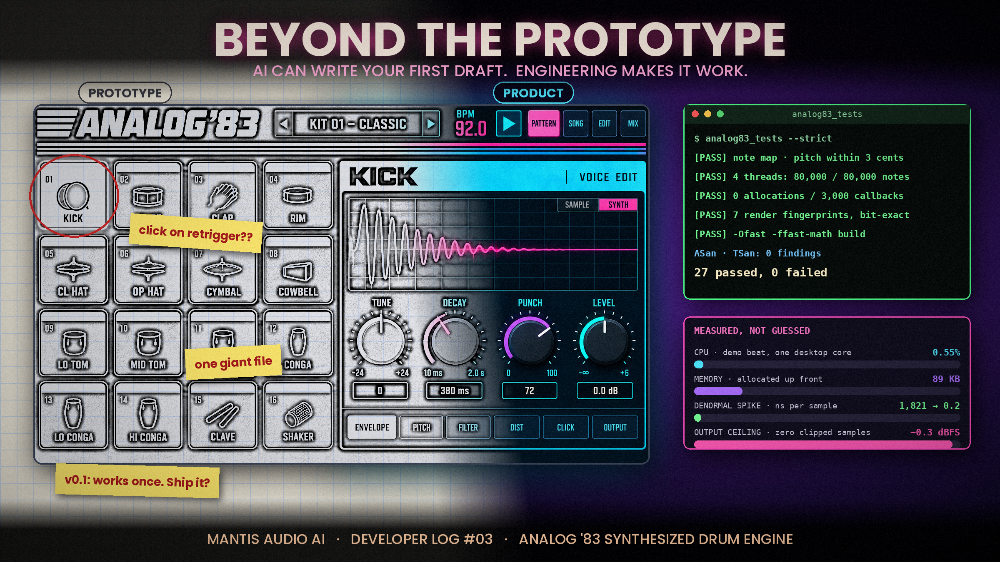

# Developer Log #03 — Beyond the Prototype

### AI can write your first draft. Engineering makes it work.

AI assisted development has changed everything about how fast software gets built. A working synth, a drum machine, a DAW style interface: you can have a functional prototype running in minutes. That's an extraordinary advance, and it's opening the door for a lot of new developers, me included.

But a prototype that runs once proves an idea. It doesn't prove reliability, performance, or that anyone can maintain it next year.

**The next challenge for developers isn't generating code. It's turning that code into software people can trust.**

#### Audio is unforgiving

Most software can hesitate for a moment and nobody notices. Audio software can't.

At 48 kHz with a 128-sample buffer, the audio engine has about **2.7 milliseconds** to produce each block of sound. Miss that deadline once and the listener hears a click, a dropout, or a stutter. Miss it during a recording and someone loses a take.

That's why audio work has its own checklist: CPU and memory efficiency, buffer underruns, MIDI timing and clock sync, latency, recording and playback staying in sync, project files that save and recover reliably, and compatibility across operating systems, audio devices, and hardware.

#### Separate the parts

The easiest prototype to build is often one giant file where the interface, audio engine, MIDI, and file saving are all tangled together. It works, until you need to change one piece without breaking the others.

For my Analog '83 drum engine, an open source proposal for the Behringer KICK, the project is split into three parts:

- **The sound engine:** plain C++ with no interface code at all. This is the only part that goes into KICK.
- **The test tools:** a test suite, a WAV renderer, and a CPU benchmark.
- **The preview app:** the touchscreen design running in a desktop window.

Because the engine stands alone, it can be tested on any computer, reviewed by other contributors, and plugged into the real hardware later without rewriting it.

#### Clean isn't the same as fast

Here's a nuance I think matters: modular code doesn't automatically mean faster code. Too many layers of abstraction can add overhead, and inside a real-time audio callback, every microsecond counts.

The goal is both: a well-organized architecture *around* the audio path, and a lean, predictable audio path itself. No memory allocation, no waiting on locks, nothing that can stall while sound is playing.

#### Test beyond the happy path

A demo shows the program working when everything goes right. Real users don't always cooperate.

Good testing pushes the edges: hours of continuous playback, loading and unloading projects over and over, twisting every knob as fast as possible, opening corrupted files, running low on memory, unplugging the audio interface mid-session.

Analog '83 has a 27-check test suite. One of my favorite tests fingerprints every demo render, recording its level every 20 milliseconds, so any change to the sound, intended or not, gets caught immediately. Another confirms the engine allocates zero memory while audio is running.

#### Measure, don't guess

"It feels fast" isn't a measurement. A benchmark is.

On a desktop test machine, the Analog '83 demo beat uses about half a percent of one CPU core, and the whole engine fits in 89 KB of memory, all set up before playback starts. Measuring also caught a sneaky problem: decaying drum tails can create tiny numbers that slow some processors to a crawl. Guarding against that eliminated those CPU spikes.

And being honest about limits is part of the job. Those numbers come from a desktop chip. KICK's ARM processor will be slower, so the real test happens on the hardware.

#### AI is a tool, not the engineer

There's nothing wrong with AI generated code, and a single file app isn't automatically bad. The risk is shipping software without understanding its architecture, its dependencies, or how it fails.

I use AI regularly as a tool, in combination with traditional coding software. But I want to be able to explain every part of what I publish, and when something breaks, I want to know why.

#### Trust is the real feature

The apps people love most aren't always the ones with the most features. They're the ones you can open every day without worrying about lost work, audio dropouts, or crashes.

**Your first prototype proves an idea can work. The engineering that follows proves people can depend on it.**

#AudioProgramming #SoftwareEngineering #MusicTech #DSP #OpenSource #CreativeCoding #AIAssistedDevelopment