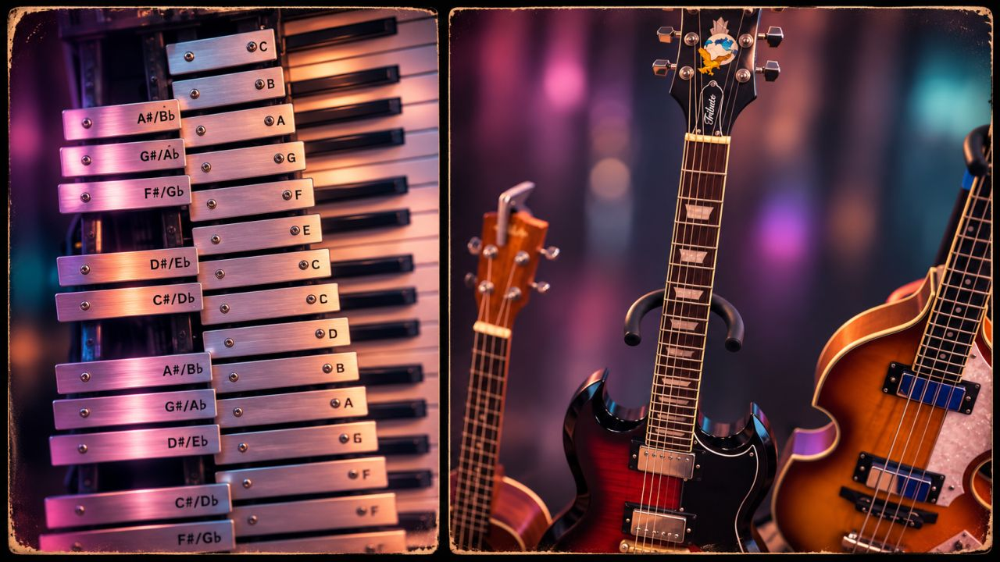

)
https://github.com/MantisAudioAI/mantisaudio-ai/blob/main/Articles/devlog-01-banner.jpeg# Developer Log #01 — Chasing the Organic Sound in a Digital World

### A little old school synthesis in the age of AI

One thing I've been exploring with my recent synthesizer projects is the intersection of **traditional sample-based synthesis, acoustic sound design, and modern AI-assisted software development.**

I'm tipping my hat to the synthesizer engineers and sound designers of the 1980s, 1990s, and early 2000s. Some of my favorite instruments from those decades used clever combinations of sampled acoustic attacks, PCM waveforms, digital oscillators, filters, and synthesized sustain to create sounds that were neither entirely acoustic nor entirely synthetic.

That hybrid approach gave those instruments a character of their own.

Today, AI makes it easier than ever to develop a reasonably capable software synthesizer. Oscillators, envelopes, filters, modulation, and keyboard interfaces can come together surprisingly quickly.

But there's still something difficult to capture: **the complex, imperfect character of a real acoustic instrument, especially those first milliseconds when a note is struck, plucked, bowed, or blown.**

Rather than relying exclusively on synthesized waveforms, I'm spending extra time recording acoustic sources, examining transients, trimming samples, selecting useful waveforms, mapping them across keyboard pitches, and experimenting with how they interact with digital synthesis.

It's a slower, sometimes messier process. But that's part of the appeal.

Three projects are helping me explore different sides of this approach:

- **The Algorithm Bell** — A dual-layer instrument exploring physical modeling, resonators, acoustic-style attacks, and traditional synthesis.

- **2K Platinum Synth** — An early-2000s-inspired hybrid workstation exploring layered textures, sample-based character, and modern digital sound design.

I'm not necessarily trying to recreate the presets of the past. I'm more interested in borrowing some of the techniques and philosophy that made those instruments so distinctive.

Sometimes I want a sound to feel convincingly real. Other times, I want it to exist somewhere between an acoustic instrument and something that could never exist in the physical world.

**AI helps me build the instruments. But the listening, experimentation, sample selection, and musical decisions are still where I want to spend my time.**

I'll be sharing more development notes, sound experiments, interface designs, and lessons learned as these projects evolve.

*More soon from the synth lab.*

#SynthDevelopment #AudioProgramming #SoundDesign #HybridSynthesis #CreativeCoding #AIAssistedDevelopment
