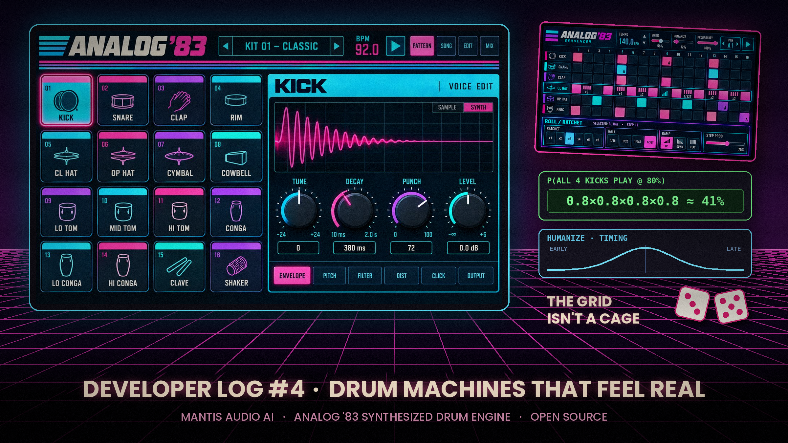

# Developer Log #04

### Probability and the Future of Drum Machines That Feel Real: Why the Grid Doesn't Have to Be a Cage

Sometimes I want a drum machine to be strict. Rigid, tight, locked to the grid, the same pattern for four minutes straight, like it's 1983 and the machine doesn't care how you feel. That sound is iconic, and it still has a place in my music.

But a lot of the time, that's not what my song needs. Real drummers drift. They lay the snare back a little, lean into the hi-hats, drop a ghost note, throw in a fill before the chorus. The music breathes.

I've spent the past year and a half building drum machines, samplers, and DAW tools, and more and more of that time goes into one question: **how do you make a machine feel human without losing what makes it a machine?**

My answer keeps coming back to probability.

#### Analog '83: my latest open source project

My newest work is for the open-source Behringer KICK project: a feature proposal for **Analog '83**, a synthesized drum engine inspired by classic early-1980s analog drum machines.

👉 [Read the Analog '83 proposal on GitHub](https://github.com/MusicTribeOpenSource/0700-AAM/issues/16)

There are no samples. The kick, snare, clap, hi-hats, toms, cowbell, and rimshot are all generated in real time by DSP. Because every hit is created live instead of played back from a file, no two are ever exactly identical. That's part of what made the original analog circuits feel alive.

The sound is only half the story. The other half is the sequencer: per-step probability, global probability, and humanize controls.

<video src="analog-83-demo.mp4" controls width="100%"></video>

#### Every step is a coin flip (and that's a good thing)

A standard 16-step sequencer is a row of on/off switches. Step on, the drum plays. Step off, silence. Completely predictable.

Probability changes one thing: each step gets a *chance* instead of a guarantee. Set a kick to 75%, and every time the sequencer reaches that step, it rolls the dice.

    if (Math.random() < stepProbability) triggerKick();

That one line is the whole idea. In math terms, it's a **Bernoulli trial**: an experiment with exactly two outcomes, play or skip. I'm taking discrete math right now, and it's been eye-opening to put names to tools I've been building by ear.

#### The math that surprised me

Say you have four kicks in a bar, each set to 80%. Feels mostly safe, right?

The chance that all four play in a given bar is 0.8 × 0.8 × 0.8 × 0.8, which is about **41%**. The other 59% of the time, at least one kick goes missing.

That's not a bug. It's how probabilities multiply when each step rolls its own dice independently. But it means a setting that feels subtle on one step can feel chaotic across a whole pattern.

Expected value helps too. Over a 120-bar song, a step that comes around once per bar and is set to 75% will play about 90 times on average (120 × 0.75). The exact count changes from song to song, because it follows a binomial distribution, but it usually lands within about 5 plays of 90. Knowing numbers like these lets me design controls that behave the way a musician expects, instead of tuning everything by trial and error.

#### Smarter randomness, not more randomness

Turning up randomness everywhere doesn't make a drum machine feel human. It makes it feel broken. Human drumming has structure, and the ideas I'm most excited about all put structure back in:

- **Probability lock.** Keep the anchors, like the kick on the downbeat and the snare on the backbeat, at 100%, so the groove stays recognizable while hats and percussion evolve around them.
- **Context-aware probability.** A ghost snare might sit at 20% most of the time but jump to 70% on every fourth bar, so variations land where a drummer would put a fill. In math terms, that's a *conditional probability*: the chance of a ghost note given which bar you're in.
- **Humanize as three separate dials.** Under the hood, "humanize" is really three questions: does the note play, when does it land, and how hard does it hit? Timing works best on a bell curve (a normal distribution), so most hits land close to the grid and big misses are rare.
- **Repeatable variation.** Seeded randomness means a pattern can surprise you and still play back the same way the next time you load the project. Variation you can keep. In practice that means a seedable random number generator, since JavaScript's built-in `Math.random()` can't be seeded.

#### Where this is heading

The next frontier is memory. Most sequencers treat every roll of the dice as independent, so what happened last bar has no effect on this one. Real drummers don't work that way. A drummer who just played a fill probably won't play another one right away.

Techniques like **Markov chains** let a machine's next choice depend on its last one. That's where I think drum programming gets genuinely interesting.

I'd love to see more developers embrace fresh approaches here. The grid is a great starting point, but it doesn't have to be a cage. Give producers a strict mode for when they want 1983, and musical, well-designed probability for when they want the track to breathe.

#DrumMachine #AudioProgramming #Probability #MusicTech #OpenSource #DSP #CreativeCoding #AIAssistedDevelopment