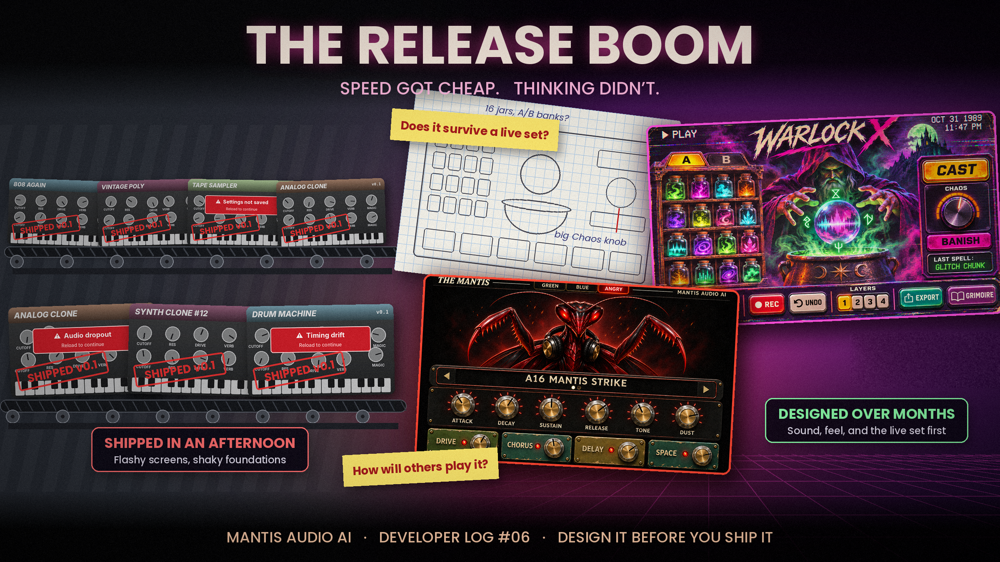

# Developer Log #06 — The Release Boom

### Speed got cheap. Thinking didn't.

In [Developer Log #03](https://mantisaudioai.github.io/mantisaudio-ai/Articles/devlog-03), I wrote about what it takes to turn an AI-built prototype into audio software people can trust. In [Developer Log #05](https://mantisaudioai.github.io/mantisaudio-ai/Articles/devlog-05), I asked what we should build once cloning classic gear becomes easy.

This one is about the step that comes before both of those: the planning. Right now, it's the step most people are skipping.

#### A release boom, not a sound design boom

Every week my feed fills up with another vibe coded synth, sampler, or drum machine. A few are genuinely clever. Most feel like the same thing: a recreation of a classic, wrapped in a flashy interface, shipped the moment it made a sound.

I build with AI tools myself, so this isn't a "the machines ruined music" post. The tools are incredible. But when building gets this fast, it turns into a race to release something, anything, before the next person does. In that race, sound design and concept come last.

**We're not in a sound design boom. We're in a release boom.**

#### What gets skipped

When I try these new instruments, the same problems keep showing up.

**Recreation without research.** Another 808, another vintage polysynth, another tape warped sampler. There's nothing wrong with honoring the past, but most of these skip the questions that matter: what did the original get right, what's missing from the market today, and who is this actually for?

**Interfaces built for the screenshot.** After 25 years as a graphic designer, I'll say it plainly: a lot of these GUIs are rushed. They look impressive in a post and fall apart when you play. Labels you can't read on stage, knobs that don't do what they look like they do, screens crowded with features nobody asked for. A great-looking interface that's hard to play is still a bad interface.

**Cracks in the foundation.** Underneath the graphics, the architecture is often shaky: audio glitches, settings that don't save, timing that drifts, parameters that jump. These are the bugs I wrote about in Developer Log #03, and a commercial release or a piece of hardware would never have gotten away with them.

**They're not fun.** This is the big one. Compared to the instruments we grew up with, hardware and commercial software alike, most of these apps just aren't as enjoyable to make music with.

#### Hardware forced the planning

I think there's a simple reason the classics feel different.

When a company built a hardware synth, every decision was expensive. Every knob cost money, every panel had to be tooled, and every chip had to be chosen before a single unit shipped. You couldn't patch a bad design next Tuesday. So the design got argued over, prototyped, played, and argued over again, sometimes for years.

AI removed that cost, which is mostly a good thing. But it also removed the checkpoint. Nothing stops you from shipping a half finished idea anymore except your own standards.

**So the planning has to come from us now.**

#### Weeks to months, not an afternoon

For the next wave of AI assisted instruments to have any real impact, I think we need to spend a few weeks, or even a few months, on each one before calling it done. Not writing code the whole time. Thinking. Here are the questions I try to work through:

**The synthesis.** What is the engine actually doing that's worth hearing? If the answer is "the same thing as the original, but in a browser," keep going.

**The sound sources.** Where do the samples come from, and why those? For Warlock X, my dark trap keys-and-synth project, I've been sampling dollar store and Walmart toys, sounds around the house, and my own instruments. Choices like that shape an instrument more than any filter ever will.

**The look, feel, and play.** How should it respond under your hands, not just in a demo video? What does each control tell you about the sound before you touch it? Does the instrument have a point of view?

**Your own songs and sets.** Where does it live in your music? Is it a sketch tool, a studio partner, or something you'd trust in front of a crowd? Does it hold up in a live set, when the lights are low and there's no time to dig through menus?

**Other people's songs and sets.** How will someone else build a beat with it, record a song with it, or perform with it? What will they push it to do that you never expected? Design for them too.

**Five to ten years from now.** How will people see this instrument later? As a classic, or as one more forgotten browser tab from 2026? The instruments that last have a clear identity. Trend chasers don't.

#### What this looks like in practice

My current project, Level 10, is a lightweight keyboard and synth module for the Behringer KICK, designed first for playing live from a setlist. It builds on what I learned from almost 10 earlier synths.

Before any code gets written, it already has:

- A defined sound goal: slightly lofi and dreamy, but modern, ready to use, and genre-neutral
- A clear structure of 10 categories with 10 presets each, plus a short Greatest Hits bank
- Three approved interface screens, including a setlist overlay built for the stage
- A Concept Review document covering 100 named presets, plus a capture checklist for every sound I plan to record and how I'll record it

There are still open questions I'm working through, like whether the setlist should hold 8 songs or 16. That's not a delay. That's the design process doing its job.

#### Study the past. Read the room.

Look at past designs, but as research, not a blueprint. Figure out why a classic worked, not just how it sounded. Then look at the current market. What's already out there? What are musicians actually asking for? What would make someone reach for your instrument instead of the dozen others on their screen?

Then build the thing only you could build.

#### The ones we still love weren't rushed

The instruments people are still cloning decades later weren't thrown together in an afternoon. People argued over them, tested them, revised them, and played them until they felt right.

AI can help us build faster than ever. It can't decide what's worth building, how it should feel, or why anyone should care.

**That part is still our job.**