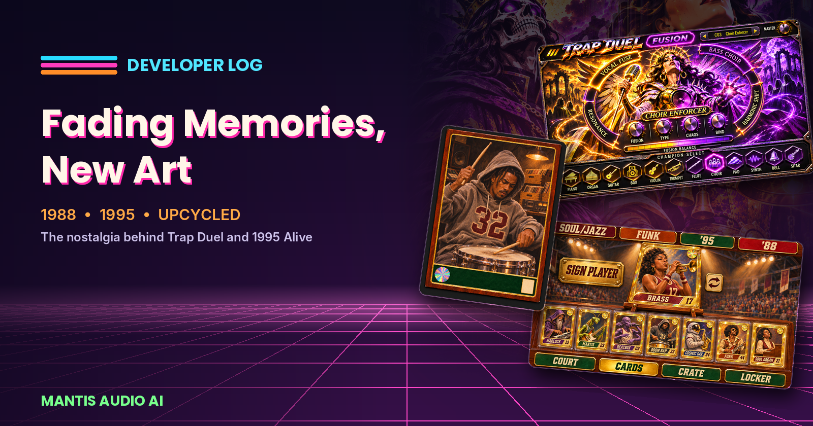

# Developer Log #07 — Fading Memories, New Art

### Borrow the feeling, never the identity.

In [Developer Log #05](https://mantisaudioai.github.io/mantisaudio-ai/Articles/devlog-05), I asked what we should build once cloning classic gear becomes easy. In [Developer Log #06](https://mantisaudioai.github.io/mantisaudio-ai/Articles/devlog-06), I ended with a challenge: build the thing only you could build.

This one is about where I find that thing. For me, it starts with memory.

#### Two projects, one source

Two of my current projects look nothing alike. One is a dark sci-fi arena full of crowned skeletons, golden queens, and subwoofer warlords. The other is a glowing '90s basketball court with holographic player cards.

But they come from the same place: two years I keep going back to, 1988 and 1995, and the things I loved when I was first figuring out the world.

#### Why we never stop going back

Before I built music software, I worked as a psychologist, and this is one of the things I find most fascinating about how people work.

Psychologists have a name for part of it: the *reminiscence bump*. When people look back on their lives, they tend to recall a disproportionate number of memories from late childhood, adolescence, and early adulthood, roughly ages 10 to 30. It's the stretch of life when we're forming who we are: our tastes, our personalities, our sense of what's cool and what matters.

The music, art, games, and objects from those years don't just sit in our memory as facts. They become anchors for identity. A comic book cover or the smell of a fresh pack of cards isn't really about the object. It's about who you were when you first held it.

Nostalgia isn't just sadness for the past, either. Research suggests it can do real good, giving people a sense of meaning, connection to others, and continuity: the feeling that the person you are now is still connected to the kid you were.

**Everyone has their own version of this. Everyone has a year.**

#### Fading memories are the point

Here's the part I find most useful as a designer. Memories aren't recordings. Every time we remember something, we rebuild it, and over time the details fade while the feeling stays.

I can't tell you the exact page layout of a comic I read in 1988. But I can tell you exactly how it *felt*: the danger, the color, the sense that the universe was enormous and strange.

That's a gift for making art. I'm not trying to recreate the original artifacts. I couldn't if I tried, and as I wrote in Developer Log #05, I wouldn't want to. I'm rebuilding the feeling that survived. The fading is what leaves room for something new.

#### 1988: Trap Duel

**Trap Duel** pulls from my late '80s obsession with comic books, especially the dark sci-fi of that era: cosmic villains, ruined empires, purple lightning, and painted covers that looked like they were glowing from the inside.

So in Trap Duel, every instrument is a character. You pick your champions from a select screen, two at a time, and fuse them. A violin becomes a golden queen in armor. An 808 becomes a hooded warlord with a subwoofer built into his chest. A bell becomes an oracle surrounded by crystal chimes. An organ is played by a crowned skeleton under a burning moon. A melodica belongs to a reaper beneath a storm.

When the Golden Violin Queen fuses with the Subwoofer Warlord, you get The Bass Duchess. Bring a choir into it and you get the Choir Enforcer. Every preset has a face and a story, the way every cover from that era promised one.

#### 1995: 1995 Alive

**1995 Alive** pulls from a different chapter: the early to mid '90s basketball and baseball card series I collected, and the early sports video games on 16-bit consoles.

If you were there, you remember. Holographic foil. Gold parallels. The thrill of pulling a rare card from a pack. Arenas full of pixel crowds, with banners hanging from the rafters.

In 1995 Alive, your sounds are your roster. Each instrument is a player card with a number: Brass, Soul Organ, Funk, Cosmic Sax, Boom Bap, Beatbox, Warlock, and Mantis. You sign players from the **Cards** screen, put your starting five on the **Court**, dig through your **Crate**, and keep your gear in the **Locker**. Championship banners for Soul/Jazz, Funk, '95, and '88 hang above it all.

**It's a beat machine, but it feels like building a team.**

#### Upcycling, not copying

Both projects follow the same rule I keep coming back to: **borrow the feeling, never the identity.**

There are no real teams, players, leagues, logos, card brands, or game titles in 1995 Alive. There are no existing comic characters in Trap Duel. Every character is original art, and every sound is built for these instruments.

I think of it as upcycling. I take the materials memory left me, such as a color palette, a kind of excitement, or the ritual of opening a pack, and build something that never existed before.

#### Why nostalgia makes better instruments

This isn't just decoration. It changes how an instrument works.

**Familiar language lowers the learning curve.** Almost everyone knows how a character select screen or a trading card works. When an interface borrows that language, people understand it before they read a manual.

**Emotion keeps people playing.** An instrument you feel something for is one you come back to. The more connected you feel, the longer you stay and the more you make.

**Identity makes it yours.** These are my years and my memories. Nobody else would build exactly these instruments, which is the best protection against becoming another clone.

#### What's your year?

For me, it's 1988 and 1995. For you, it might be the year of your first video game, your first concert, or the album you wore out on cassette.

Whatever it is, I'd encourage anyone making art to look there. Not to copy what you loved, but to ask what it made you feel.

**Then build something new that makes someone else feel it too.**