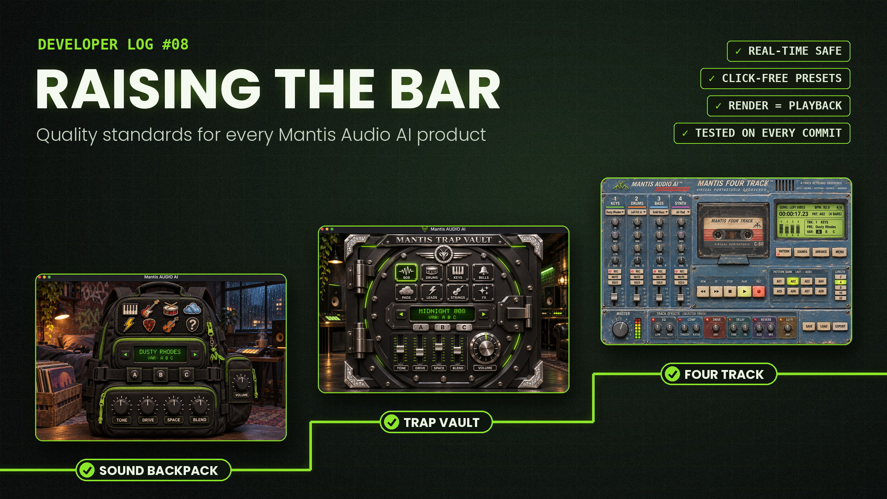

# Developer Log #08 — Raising the Bar

### Smaller products, more solid code, and a checklist that grows with every release.

In [Developer Log #03](https://mantisaudioai.github.io/mantisaudio-ai/Articles/devlog-03), I wrote about what it takes to move beyond the prototype. In [Developer Log #06](https://mantisaudioai.github.io/mantisaudio-ai/Articles/devlog-06), I wrote about the release boom and why planning and design matter more than shipping fast.

This post is where those ideas become something I can actually follow: a written set of quality standards for every Mantis Audio AI product from now on, starting with the Sound Backpack.

The goal isn't to build bigger products. It's to build more solid ones, ship more of them, and learn real software engineering along the way. Every release adds to the checklist, so the bar rises as I learn.

#### Why now

Early prototypes taught me a lot. But quick builds hide problems. A plugin can sound great on its own, then click, spike the CPU, or jump in volume once it's inside a real DAW session next to ten other tracks.

The Sound Backpack is my first finished public release. That makes now the right moment to set the standard, before bad habits spread across the whole product line.

And honestly, I want code I'd be proud to show other developers and recruiters, not code that just happens to run.

#### Plan before code

Every product starts with a written spec. Then the build happens in small stages: an empty plugin that loads, then the engine, then presets, then the interface, then testing. After each stage, I stop, listen, and review before moving on.

It sounds slower, but in practice it's often faster, because problems get caught while they're small and easy to find.

#### Every piece has one job

The audio engine, the plugin wrapper, and the interface are separate layers. The interface never touches audio directly. It only changes parameters, and the engine reads those changes safely on its own schedule.

Inside the engine, each piece is its own small class with one job: the voice, the filter, the envelope, each effect, the preset manager, and MIDI input. When something breaks, I know where to look. When I want to reuse a filter, it's already a self contained part.

#### Rules that persist

I work with AI coding tools, and every new session starts without the memory of the last one. So I keep a rules file in the repo, and every session follows the same standards, not just the first one. Without it, session four can quietly drift away from what session one agreed on.

#### Tests, and never trusting input

Each DSP piece and the preset system has its own unit tests, and automated builds run them on every commit. If a change breaks something, I find out right away, not from a producer halfway through a session.

Input files are never trusted. Presets are validated when they load. A broken file is skipped with a message. It never crashes the plugin, and it never takes the DAW down with it.

#### Plan for the future

Some decisions are hard to change later, so I make them on day one. Plugin IDs are locked from the start, so DAWs always recognize the plugin and saved sessions keep loading. Preset formats are versioned, so old presets still load after updates. Factory content is protected, so nobody overwrites it by accident.

#### A real target machine

My baseline isn't a powerful studio computer. It's my own Windows 11 laptop, an i5 with 8 GB of RAM, running a DAW with other plugins open. If a product runs well there, it should run well for most producers.

#### The audio thread has rules

Audio software has its own set of problems, and this is where I'm learning the most.

Real-time safety comes first. The audio thread never allocates memory, waits on locks, or reads files. Any of those can make it miss its deadline, and a missed deadline is a click or a dropout.

Every knob and slider is smoothed, so moving a control never causes zipper noise. Denormal protection, voice limits, and voice stealing keep the CPU from spiking without warning.

Anti-aliasing goes where it matters: band-limited oscillators, anti-aliased drive, and quality interpolation for repitched samples. It goes nowhere else, because CPU is a budget, and I want to spend it where you can hear the difference.

Effects and voices go to sleep when they're silent, but only after their tails have truly faded. If you cut a reverb off early to save CPU, you'll hear it.

#### Consistent levels

Switching presets should never surprise you. Gain staging leaves headroom, preset changes are click-free, and every preset has its own level trim. I also run a loudness check that plays the same phrase through every preset, so volume jumps show up before release instead of in someone's mix.

#### Render equals playback

What you hear while playing should be exactly what you get when you bounce. I check this with a null test: record the same part in real time and render it offline, flip the polarity of one, and play them together. If they match, they cancel to silence. If anything is left over, something is different. (Anything random, like subtle analog style drift, has to use the same seed in both passes, or the test can't work.)

#### Works where people actually are

In the standalone app, USB and Bluetooth MIDI keyboards should just work, and the computer keyboard takes over when nothing is plugged in. Inside a DAW, the host handles MIDI devices, so the plugin's job is to respond correctly to whatever it receives.

Samples are stored as lossless FLAC, only what's needed gets loaded, and the interface redraws only what changes.

Then everything goes through a strict automated plugin validator and gets tested in several DAWs, because every host has its own quirks.

#### Standards beyond code

Quality isn't only about the code.

Every sample is logged with the date, place, and device it was recorded on. The raw original is kept untouched, and all editing happens on copies.

Presets and labels never use brand or model names.

Licensing is clear from the start: the code is source available for viewing, the samples have their own terms for producers (free to use in your music, not to redistribute), and the samples stay out of the public repo.

#### The bigger point

This checklist isn't just for the Backpack. It carries across the whole line: the Sound Backpack, the Trap Vault, the Four Track, and whatever comes next. Every new product starts from the checklist and adds whatever it taught me.

**Shipping several smaller, solid products teaches me more than one giant project that never leaves my computer.**